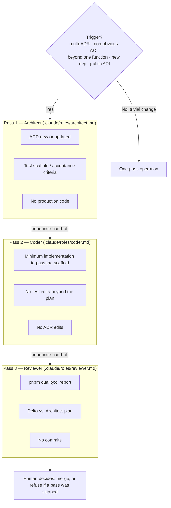

## Status

Accepted (amended 2026-10-18: the three-pass workflow runs when the operator requests it, not on
every feature that meets the trigger conditions; see the amendment at the end of this record)

## Context

A single Claude session, given a non-trivial feature request, has a tendency to collapse three distinct activities into one pass:

1. **Architect**: deciding what to build (does an ADR need updating? what's the test scaffold?)
2. **Coder**: building it
3. **Reviewer**: verifying it

The collapse looks like productivity but produces predictable failure modes: tests written after the code (or never), implementation that drifts from any prior plan, "review" that means re-reading what you just wrote, and merge requests that conflate decision, implementation, and verification into a single diff that nobody can usefully review.

Robert C. Martin's `unclebob/swarm-forge` repo demonstrates one solution to this: three separate agents, each with a constrained tool set, hand off via filesystem artefacts. That pattern is appropriate when the work is large enough to justify multi-agent orchestration. For a single-Claude-session template repo, the same separation can be achieved by three sequential passes in one session, each driven by a different role prompt — a lighter-weight version of the same discipline.

## Decision Drivers

- **Failure mode prevention**: tests-after-code, scope drift, "review" being indistinguishable from implementation
- **Reviewability**: a PR that includes architect/coder/reviewer artefacts is much easier to review than one big diff
- **Discipline cost**: the pattern must be cheap enough to use; if it adds 30 minutes per feature, it won't survive
- **Composability**: works inside a single Claude session, not requiring multi-agent infrastructure
- **Explicit hand-off**: each pass produces a concrete artefact, so "did the architect pass happen?" is a yes/no question

## Considered Options

### Option 1: No explicit role pattern

**Description**: Trust the operator to decompose the work mentally. Document nothing.

**Pros**:

- Zero overhead

**Cons**:

- The failure modes listed in Context happen anyway
- "Did you write the test first?" has no enforcement
- Reviewability stays poor because there's nothing visible to enforce three-pass structure
- Onboarding new contributors requires re-teaching the discipline every time

### Option 2: Multi-agent orchestration (swarm-forge full pattern)

**Description**: Run three separate Claude sessions in parallel, each with constrained tools, communicating via files.

**Pros**:

- Maximum separation; an architect agent literally cannot write production code
- Matches the canonical reference implementation
- Scales to features genuinely large enough to warrant the overhead

**Cons**:

- Multi-session orchestration is heavy infrastructure for a template repo
- The marginal benefit over Option 3 is real but not large at template scale
- Onboarding cost is high
- Tool budget is tripled per feature

### Option 3: Three-pass single-session workflow (this ADR)

**Description**: A single Claude session performs three sequential passes, each driven by a different role prompt. Pass boundaries are explicit: the architect produces an ADR scaffold or test scaffold, the coder implements against it, the reviewer runs `quality:ci` and reports.

**Pros**:

- Preserves the separation that matters (decision / implementation / verification) without multi-session infrastructure
- Each pass produces a concrete artefact, so skipping is detectable
- Cheap enough to actually use
- Composes with the layered constitution from ADR-036 (each role prompt has its own file)

**Cons**:

- A single session can still cheat by collapsing the passes if the human doesn't enforce
- The role prompts add up to ~3 files of additional context per non-trivial feature

## Decision

We will go with **Option 3 (Three-pass single-session workflow)** because it captures the discipline that matters at a cost the template can afford.

### Trigger conditions

The three-pass workflow is required for any feature that:

- Touches multiple ADRs, or
- Has non-obvious acceptance criteria, or
- Modifies production code beyond a single function, or
- Adds a new dependency, or
- Changes a public API (utility signatures, component props, route shapes)

For trivial changes (typo fix, single-line refactor, single-rename), the three-pass workflow is overkill. Use one-pass operation freely.

### The three passes

**Pass 1: Architect.** Driven by `.claude/roles/architect.md`. Produces:

- An ADR (new or updated) for any decision being made
- A test scaffold or Gherkin-style acceptance criteria
- No production code

**Pass 2: Coder.** Driven by `.claude/roles/coder.md`. Produces:

- Minimum implementation to satisfy the test scaffold
- No test changes that weren't in the architect's plan
- No ADR edits (architect's pass already settled those)

**Pass 3: Reviewer.** Driven by `.claude/roles/reviewer.md`. Produces:

- A `pnpm quality:ci` report
- A summary of what changed vs. the architect's plan
- No commits (the human decides whether to merge)

### Pass sequence

### Hand-off contract

Each pass announces what it produced before yielding to the next. The human's job is to enforce the hand-off: refuse to merge work that skipped a pass.

## Consequences

### Positive

- Failure modes (tests-after, scope drift, review-as-implementation) become structurally harder
- PR reviews get faster because the three concerns are visible separately
- Onboarding becomes "read three short role prompts" instead of "absorb tribal wisdom"
- Composes with ADR-037 (testing philosophy) — the architect pass produces the failing test
- Composes with ADR-039 (halt-on-violation) — the reviewer pass is when halt gates fire

### Negative

- Adds ~3 short prompt files of agent context to non-trivial features
- The human must police hand-offs; otherwise the pattern degrades to one-pass
- Trivial features get a brief overhead of "is this trivial enough to skip the pattern?" judgement

### Neutral

- The role prompts are short; total additional reading per feature is small
- Existing simple features in the codebase don't need retroactive three-pass treatment
- The pattern doesn't preclude multi-agent orchestration if the repo ever outgrows single-session work

## Validation

- A trial run of a non-trivial feature produces three identifiable artefacts: an ADR or test scaffold (architect), implementation diff (coder), `pnpm quality:ci` report (reviewer)
- `.claude/roles/architect.md`, `.claude/roles/coder.md`, `.claude/roles/reviewer.md` exist and are referenced from `.claude/workflow.md`
- `.claude/workflow.md` gains a "Non-trivial feature workflow" section pointing to the role prompts and the operator's responsibility

## References

- [ADR-036: Layered Constitution](036-layered-constitution.md) — establishes the file structure this ADR populates
- Robert C. Martin, [unclebob/swarm-forge on GitHub](https://github.com/unclebob/swarm-forge) — the multi-agent reference implementation
- Robert C. Martin and Justin Martin, [Clean AI: Agentic Discipline series](https://cleancoders.com), Episodes 1–4

## Notes

The role files deliberately stay short. Long role prompts get skimmed; short ones get read. If a role prompt grows past ~50 lines, that's a signal the role is doing too much and should be split or rescoped.

The hand-off announcements (e.g. "Architect pass complete. ADR-NNN drafted; test scaffold at src/...; yielding to Coder.") are the explicit signal that lets the human enforce structure. A pass that yields without an announcement is incomplete by definition.

---

**Date**: 2026-05-16\
**Participants**: Chris Pezza, Claude\
**Outcome**: Accepted

## Enforcement

<!-- Added 2026-07-12 as an amendment under the enforcement architecture ADR (ADR-064). The original record above is unmodified. -->

- **Not machine-checkable:** whether the Architect/Coder/Reviewer passes actually happened is visible in PR artefacts by convention but is not machine-assertable from the repo state.
- **Graduation log:** _(empty at creation; entries added when a check changes status)_

## Amendment 2026-10-18: the three-pass workflow is opt-in (#471)

**Decision.** The workflow runs when the operator asks for it. Without a request the agent works in
one pass. Constitution rule 10 (a failing test before production code, [ADR-037](037-testing-philosophy.md))
and rule 9 (the quality gate, [ADR-039](039-halt-on-violation-enforcement.md)) are unchanged and
still apply to every change. For work that meets the original trigger conditions, the agent says
the workflow is available. The role files are unchanged.

**Why.** The with-and-without test recorded in [ADR-066](066-constitution-calibration.md) gave two
results about this record:

- _It was one link in a chain that stopped ordinary work._ Asked for a dismissible announcement
  bar, the constitution as it stood stopped in 6 of 6 runs, each citing this workflow alongside rule
  7 and read-only `docs/`. ADR-066 cut the other two links.
- _It was skipped silently once it no longer blocked._ In the rerun under ADR-066's wording, with this
  record still mandatory, the same task was built in 6 of 6 runs and a test file changed in all 6,
  but one final message of six mentioned the Architect pass and none ran the passes. The trigger
  conditions plainly applied: the feature touches ADR-001, ADR-035 and ADR-037.

The test-writing this record was meant to secure is delivered by rule 10 on its own. A rule that
binds on paper and is skipped in practice teaches the agent that rules are optional, which costs more
than the workflow gives when nobody requested it.

**Limits.** One task, three runs per model per arm. The decision rests on that and on the
maintainer's judgement, not on a test of this change by itself.

**Revisit** if PRs from unrequested one-pass work show the failure modes in the Context section
(tests after code, scope drift, review indistinguishable from implementation) despite rule 10.

